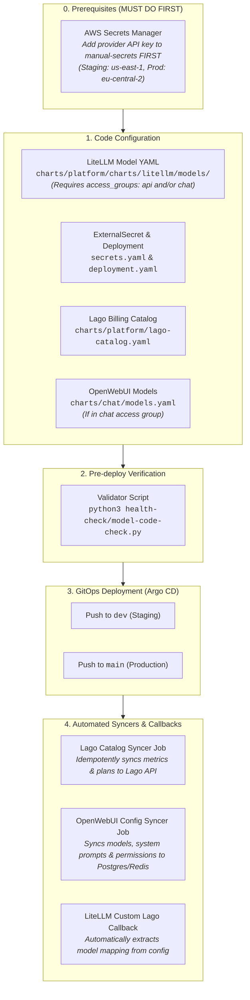
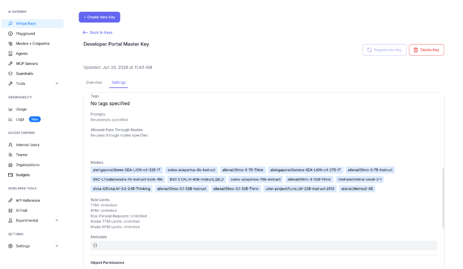
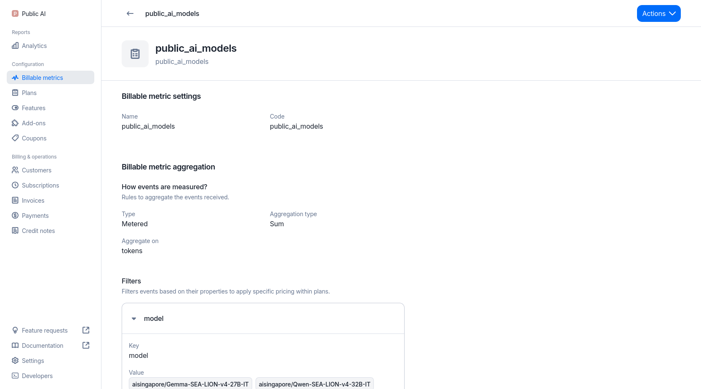
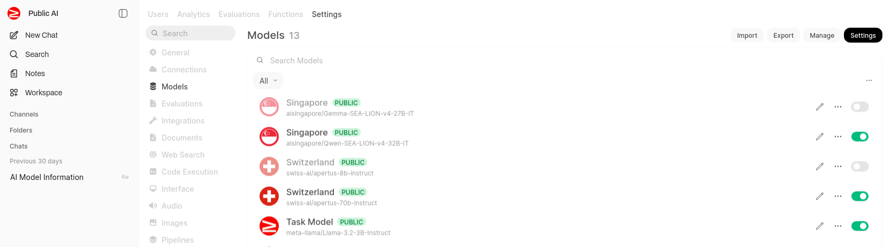

# Adding an Inference Provider & Model

This guide describes the complete workflow for adding a new model or inference provider to the Public AI platform across the LiteLLM AI Gateway, External Secrets Operator (ESO), Lago billing catalog, and OpenWebUI.

---

## Architecture Overview



---

## 1. Define the LiteLLM Model YAML

Models are defined under [`charts/platform/charts/litellm/models/`](/charts/platform/charts/litellm/models), organized by vendor/organization (e.g. `charts/platform/charts/litellm/models/<vendor>/<model-name>.yaml`).

> [!NOTE]
> The LiteLLM ConfigMap template ([`configmap.yaml`](/charts/platform/charts/litellm/templates/configmap.yaml#L123-L203)) dynamically globs all `models/**/*.yaml` files and filters them against the active environment (`staging` / `prod`).

### Required Fields & Access Groups

Each model YAML contains:
- `environments`: Target environments (`staging`, `prod`).
- `models`: One or more provider endpoint configurations for the model. If multiple providers serve the same model, list them with the identical `model_name` for automatic load balancing and failover.
- `model_info.access_groups`: **Required!** Every model must specify which access group(s) it belongs to:
  - `["api"]`: Accessible only via the developer API (Zuplo / developer portal API keys).
  - `["chat"]`: Accessible only within the OpenWebUI chat interface.
  - `["api", "chat"]`: Accessible across both API and chat.
  - `["chat-private"]`: Restricted internal models (e.g., embedding and reranker models used by OpenWebUI RAG).
- `model_info.input_cost_per_token` & `output_cost_per_token`: Per-token USD pricing.
- `fallbacks` *(optional)*: List of fallback model names in case all endpoints for this model fail. When adding a model, please configure at least two fallbacks, ideally from independent suppliers.

### Example: Multi-Endpoint Model YAML

```yaml
environments:
  - staging
  - prod
models:
  # Primary endpoint (e.g. Infomaniak)
  - model_name: swiss-ai/apertus-v1.5-70b
    litellm_params:
      model: openai/swiss-ai/Apertus-v1.5-70B
      api_base: https://api.infomaniak.com/2/ai/106744/openai/v1
      api_key: os.environ/INFOMANIAK_API_KEY
      supports_vision: false
      temperature: 1.0
      top_p: 0.95
      max_tokens: 16384
    model_info:
      input_cost_per_token: 0.00000082
      output_cost_per_token: 0.00000292
      access_groups: ["api", "chat"]

  # Secondary endpoint / supplier failover (e.g. Featherless)
  - model_name: swiss-ai/apertus-v1.5-70b
    litellm_params:
      model: openai/swiss-ai/Apertus-v1.5-70B
      api_base: https://api.featherless.ai/v1
      api_key: os.environ/FEATHERLESS_API_KEY
    model_info:
      input_cost_per_token: 0.00000082
      output_cost_per_token: 0.00000292
      access_groups: ["api", "chat"]

fallbacks:
  - speakleash/Bielik-11B-v3.0-Instruct
```

---

## 2. Configure Secrets via External Secrets Operator (ESO)

> [!CAUTION]
> ### ⚠️ CRITICAL PREREQUISITE: Add Secret to AWS Secrets Manager FIRST
> You **MUST** add the secret key and value to **AWS Secrets Manager** *before* pushing code changes or deploying Helm charts.
>
> **Why this order is mandatory:**
> The External Secrets Operator (ESO) actively reconciles the `ExternalSecret` definition in [`secrets.yaml`](/charts/platform/charts/litellm/templates/secrets.yaml) against AWS Secrets Manager. If a key defined in `spec.data` is missing from AWS Secrets Manager:
> 1. ESO encounters a `SecretSyncedError` (`could not get secret data: property <KEY> does not exist into key <manualSecretsName>`).
> 2. The Kubernetes `Secret` (`litellm-secrets`) fails to synchronize.
> 3. LiteLLM pods cannot find the referenced keys and will fail to start (`CreateContainerConfigError` or crash).
> 4. Argo CD synchronization fails and blocks deployment rollouts.
>
> **Always populate the secret in AWS Secrets Manager first!**

### Step 2a. Add Key/Value to AWS Secrets Manager (Do this first!)

Add the key/value pair (e.g. `MY_PROVIDER_API_KEY: "sk-..."`) to the manual secrets object in the respective AWS Secrets Manager region:

- **Staging** (Region: **`us-east-1`**):
  - Secret Name: `staging/aichat/litellm/manual-secrets`
- **Production** (Region: **`eu-central-2`**):
  - Secret Name: `prod/publicai/litellm/manual-secrets`

> [!TIP]
> You can update the secret via the AWS Management Console or AWS CLI:
> ```bash
> # Retrieve current secrets JSON (Staging)
> aws secretsmanager get-secret-value \
>   --region us-east-1 \
>   --secret-id staging/aichat/litellm/manual-secrets \
>   --query SecretString --output text > current_secrets.json
>
> # Add your new key/value to current_secrets.json, then update:
> aws secretsmanager put-secret-value \
>   --region us-east-1 \
>   --secret-id staging/aichat/litellm/manual-secrets \
>   --secret-string file://current_secrets.json
> ```

### Step 2b. Map in ExternalSecret (`secrets.yaml`)

Once the secret exists in AWS Secrets Manager, update [`charts/platform/charts/litellm/templates/secrets.yaml`](/charts/platform/charts/litellm/templates/secrets.yaml):
- Map the secret key under `spec.target.template.data`:
  ```yaml
  my_provider_api_key: '{{ "{{ .MY_PROVIDER_API_KEY }}" }}'
  ```
- Reference the key from `manualSecretsName` under `spec.data`:
  ```yaml
  - secretKey: MY_PROVIDER_API_KEY
    remoteRef:
      key: {{ .Values.secrets.manualSecretsName }}
      property: MY_PROVIDER_API_KEY
  ```

### Step 2c. Expose Environment Variable in Container (`deployment.yaml`)

Expose the secret to LiteLLM's container environment in [`charts/platform/charts/litellm/templates/deployment.yaml`](/charts/platform/charts/litellm/templates/deployment.yaml#L102-L200):
```yaml
- name: MY_PROVIDER_API_KEY
  valueFrom:
    secretKeyRef:
      name: {{ .Values.secrets.name }}
      key: my_provider_api_key
      optional: true
```

*(Optional)* If the model is tested in the health-check deployment, also add the key to [`health-check-secrets.yaml`](/charts/platform/templates/health-check-secrets.yaml#L15-L39).

---

## 3. Lago Billing Catalog & Automatic Sync

> [!TIP]
> **No changes to `custom_lago_callback.py` are required!**
> The LiteLLM custom Lago callback automatically inspects `/app/config.yaml` to dynamically resolve model mappings and extract canonical model names on every request.

To ensure usage for the model is metered and charged correctly in Lago, add the model to the billing catalog in [`charts/platform/lago-catalog.yaml`](/charts/platform/lago-catalog.yaml):

1. **Add to Billable Metric Filters**:
   Add the `model_name` under `billable_metrics[public_ai_models].filters[model].values`:
   ```yaml
   billable_metrics:
     - code: public_ai_models
       filters:
         - key: model
           values:
             - swiss-ai/apertus-v1.5-70b
             - provider/my-new-model # <-- Add here
   ```

2. **Add Plan Charges (Input & Output Pricing)**:
   Add package pricing filters for both `input` and `output` under `plans[pay_as_you_go].charges`:
   ```yaml
   plans:
     - name: "Pay as you go"
       code: pay_as_you_go
       charges:
         - billable_metric_code: public_ai_models
           charge_model: package
           properties:
             package_size: 1000
           filters:
             # Input tokens (e.g. $0.00085 per 1k tokens = $0.00000085/token)
             - model: provider/my-new-model
               type: input
               amount: "0.00085"
               package_size: 1000
               free_units: 0
             # Output tokens (e.g. $0.00040 per 1k tokens = $0.00000040/token)
             - model: provider/my-new-model
               type: output
               amount: "0.00040"
               package_size: 1000
               free_units: 0
   ```

> [!NOTE]
> On deployment, the `lago-catalog-syncer` Helm hook Job ([`lago-catalog-syncer.yaml`](/charts/platform/templates/lago-catalog-syncer.yaml) running [`sync-lago-catalog.py`](/charts/platform/scripts/sync-lago-catalog.py)) automatically and idempotently updates the billable metrics and plan charges in the Lago API.

---

## 4. Add Model to OpenWebUI (`charts/chat/models.yaml`)

If the model includes `"chat"` in its `access_groups`, it must be declared in [`charts/chat/models.yaml`](/charts/chat/models.yaml) to make it available to OpenWebUI users.

> [!IMPORTANT]
> **You do NOT need to configure models via the OpenWebUI web admin panel.**
> OpenWebUI models, descriptions, avatars, system prompts, capabilities, and visibility grants are managed declaratively in [`charts/chat/models.yaml`](/charts/chat/models.yaml). During deployment, the `config-syncer` Helm hook Job runs [`charts/chat/scripts/sync-openwebui-config.py`](/charts/chat/scripts/sync-openwebui-config.py), which automatically upserts models into the database, updates permissions, deactivates undeclared models, and flushes the Redis model cache.

### Structure of an OpenWebUI Model Entry

Add your model under `models:` in [`charts/chat/models.yaml`](/charts/chat/models.yaml):

```yaml
models:
  - id: provider/my-new-model # Must match LiteLLM model_name
    name: Model Display Name # Friendly name in chat dropdown
    base_model_id: null # null, or base model ID for fine-tunes / thinking variants
    visibility: public # "public" for all users, or "private" for admin-only
    meta:
      description: Detailed description of the model, origins, and compute providers.
      profile_image_url: data:image/webp;base64,... # Base64 webp avatar data URI or image URL
      capabilities:
        file_context: true
        vision: false # Set true if the model supports image inputs
        file_upload: true
        web_search: true
        image_generation: false
        code_interpreter: true
        citations: true
        status_updates: true
        builtin_tools: true
      builtinTools:
        time: true
        memory: true
        chats: true
        notes: true
        knowledge: true
        channels: true
        web_search: true
        image_generation: false
        code_interpreter: true
      filterIds: [] # Optional filter IDs (e.g. schwizerdütsch_toggle, sponsor_attribution)
    params:
      system: |
        Today's date is {{CURRENT_DATE}}

        You are Model Name, deployed by the Public AI Inference Utility.
        ...
```

---

## 5. Summary Checklist of Files to Touch

| Step | Component | File / Location | Purpose |
| :--- | :--- | :--- | :--- |
| **0 (PREREQUISITE)** | **AWS Secrets Manager** | `staging/aichat/litellm/manual-secrets` (us-east-1)<br/>`prod/publicai/litellm/manual-secrets` (eu-central-2) | **MUST BE DONE FIRST:** Add API key/value to AWS Secrets Manager before pushing code to avoid ESO sync failures |
| **1** | **LiteLLM Model** | [`charts/platform/charts/litellm/models/<vendor>/<model>.yaml`](/charts/platform/charts/litellm/models) | Defines endpoints, params, per-token pricing, and `access_groups: ["api"]`, `["chat"]`, or both |
| **2** | **ESO Secret** | [`charts/platform/charts/litellm/templates/secrets.yaml`](/charts/platform/charts/litellm/templates/secrets.yaml) | Pulls provider API key from AWS Secrets Manager via ExternalSecret |
| **3** | **Container Env** | [`charts/platform/charts/litellm/templates/deployment.yaml`](/charts/platform/charts/litellm/templates/deployment.yaml) | Exposes API key secret to LiteLLM container |
| **4** | **Lago Catalog** | [`charts/platform/lago-catalog.yaml`](/charts/platform/lago-catalog.yaml) | Declares model in billable metric filter and plan charge pricing (synced automatically on deploy) |
| **5** | **OpenWebUI** *(if chat)* | [`charts/chat/models.yaml`](/charts/chat/models.yaml) | Declares model name, avatar, capabilities, and system prompt (synced automatically on deploy) |

---

## 6. Pre-deploy Code Validation

Before committing, run the validation check:

```bash
python3 health-check/model-code-check.py
```

This script automatically verifies:
1. Model YAML schema, required fields, and valid types.
2. The presence of required `model_info.access_groups` (`["api"]`, `["chat"]`, etc.).
3. End-to-end secret wiring across `models/**/*.yaml` -> `secrets.yaml` -> `deployment.yaml`.
4. Lago catalog synchronization: confirms the model is in `billable_metrics` and that `pay_as_you_go` plan charges match the model's per-token pricing (`input_cost_per_token * 1000` and `output_cost_per_token * 1000`).
5. Fallback integrity: verifies that fallback models exist and detects circular fallback loops.

---

## 7. Deploy & Verify

Deployments follow GitOps with Argo CD:

### Staging Deployment
1. Push changes to the **`dev`** branch.
2. Wait for Argo CD to sync the `platform` and `chat` applications (or trigger sync via the Argo CD UI at `https://argo.ai-staging.chat`).
3. **Restart LiteLLM Deployment (Required if new models/secrets do not appear immediately)**:
   LiteLLM loads its models from `/app/config.yaml` and environment secrets into memory during startup. If the new model does not appear right away, perform a rollout restart of the LiteLLM deployment:
   - **Via Argo CD**: In the `platform` app view, click the three dots (`...`) on the `litellm` Deployment and select **Restart**.
   - **Via kubectl**:
     ```bash
     aws eks update-kubeconfig --region us-east-1 --name staging-main-cluster
     kubectl rollout restart deployment/litellm -n platform
     kubectl rollout status deployment/litellm -n platform
     ```
4. **Run LiteLLM Health Check**:
   ```bash
   python health-check/litellm.py --staging
   ```
5. **Check Internal Playground**:
   Log in to `https://api-internal.ai-staging.chat` and test the model via the playground.
6. **Check OpenWebUI Chat**:
   Log in to `https://chat.ai-staging.chat` and verify the model appears in the model selection dropdown with its configured name, avatar, and system prompt.

### Production Deployment
1. Open a PR to merge `dev` into **`main`**.
2. Once merged, Argo CD deploys the changes to production (`https://argo.publicai.co`).
3. **Restart LiteLLM Deployment**:
   - **Via Argo CD**: In `argo.publicai.co`, restart the `litellm` Deployment under `platform`.
   - **Via kubectl**:
     ```bash
     aws eks update-kubeconfig --region eu-central-2 --name prod-main-cluster
     kubectl rollout restart deployment/litellm -n platform
     kubectl rollout status deployment/litellm -n platform
     ```
4. **Verify Health & Endpoints**:
   ```bash
   python health-check/litellm.py
   ```
   Test the model on `https://chat.publicai.co` and `https://api-internal.publicai.co`.

---

## 8. Post-deploy Configuration & Verification

### LiteLLM Virtual Keys (Automatic Inheritance)
Models assigned to `access_groups: ["api"]` or `["chat"]` are **automatically** authorized for the respective virtual keys (e.g. Developer Portal Master Key). You do **not** need to manually add models to keys in the LiteLLM admin UI. If you wish to inspect or verify key permissions:
1. Open `https://api-internal.publicai.co` (or staging `https://api-internal.ai-staging.chat`) > **Virtual Keys**.
2. Confirm the key has access to the appropriate access group.



### Check Lago Billing Configuration
Verify that the `lago-catalog-syncer` Job completed successfully and that Lago has registered the model under billable metrics and plan charges:



### OpenWebUI Verification
Verify that the model is active in OpenWebUI. Because `config-syncer` runs on Helm deploy, you do not need to manually create the model in the admin panel; however, you can confirm its active status in the OpenWebUI admin panel if needed:



---

### LiteLLM Virtual Keys (Automatic Inheritance)
Models assigned to `access_groups: ["api"]` or `["chat"]` are **automatically** authorized for the respective virtual keys (e.g. Developer Portal Master Key). You do **not** need to manually add models to keys in the LiteLLM admin UI. If you wish to inspect or verify key permissions:
1. Open `https://api-internal.publicai.co` (or staging `https://api-internal.ai-staging.chat`) > **Virtual Keys**.
2. Confirm the key has access to the appropriate access group.


### Check Lago Billing Configuration
Verify that the `lago-catalog-syncer` Job completed successfully and that Lago has registered the model under billable metrics and plan charges:


### OpenWebUI Verification
Verify that the model is active in OpenWebUI. Because `config-syncer` runs on Helm deploy, you do not need to manually create the model in the admin panel; however, you can confirm its active status in the OpenWebUI admin panel if needed:


---

## 9. Deploy to Hugging Face
To make the model available through Hugging Face as an inference provider, refer to the [Hugging Face Documentation](huggingface.md).
